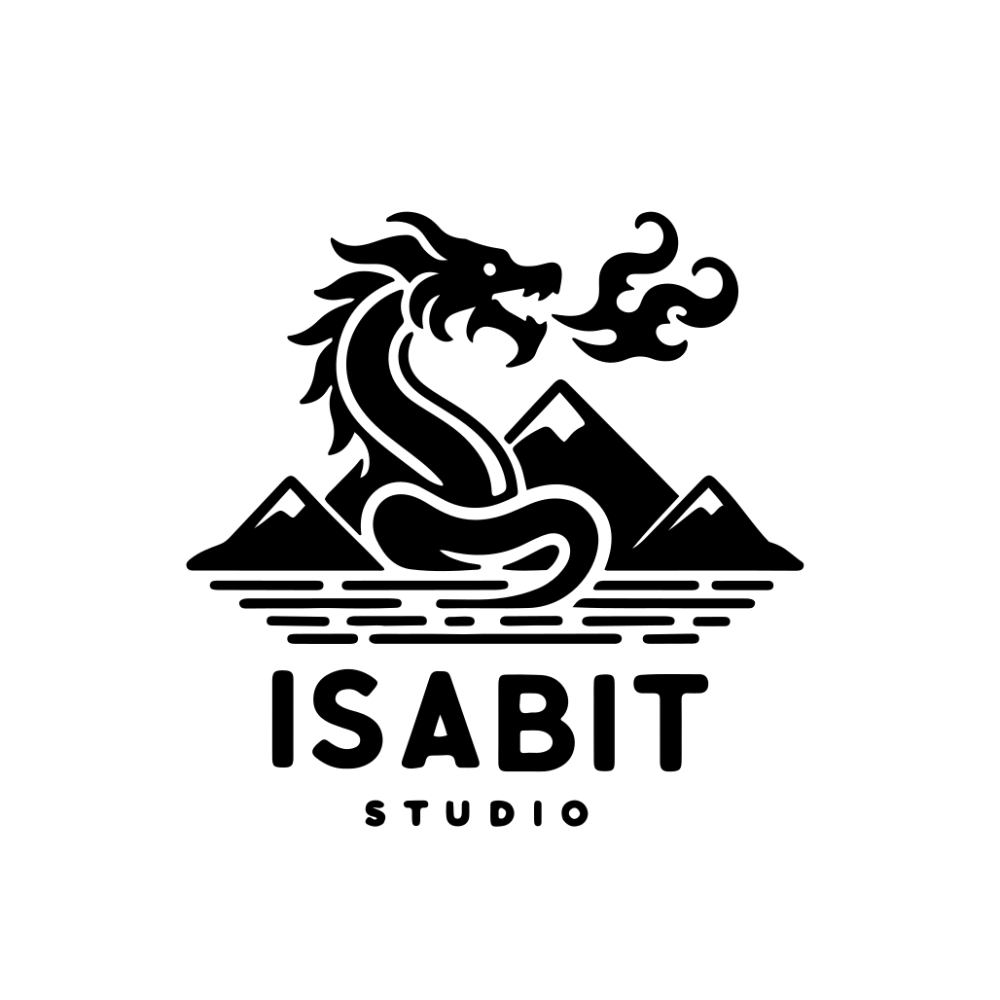

<p align="center">
  <picture>
    <source media="(prefers-color-scheme: dark)" srcset="resources/logo_light.png">
    <source media="(prefers-color-scheme: light)" srcset="resources/logo_dark.png">
    
  </picture>
</p>

<h1 align="center">Pireneus</h1>

<p align="center">
  A 2D / 3D game engine written in <b>Orthodox C++</b>, by <b>Isabit Studio</b>.<br>
  Vulkan and DirectX 12 · photorealistic rendering · scene and level editor · Box2D / Box3D physics.
</p>

---

## Overview

Pireneus is a game engine written mostly in C, in the spirit of
[Orthodox C++](https://bkaradzic.github.io/posts/orthodoxc++/): simple, explicit code, with no advanced
templates, exceptions, RTTI or heavy STL. C++ is only used where a library requires it (Dear ImGui,
VMA, C++/WinRT) and for the tools.

What it includes:

- **Rendering**: a minimal RHI with two backends, **Vulkan** and **DirectX 12**. Both are compiled into
  the same binary, and one is picked at startup. On top of it:
  - batched 2D rendering, with an API inspired by XNA / MonoGame;
  - a forward 3D renderer with shadows;
  - a **photorealistic renderer**: visibility buffer, PBR, IBL, GTAO, bloom, tone mapping.
- **Shaders**: a single [Slang](https://shader-slang.org/) source for both backends (SPIR-V and DXIL).
- **Platforms**: Windows (Win32 through SDL3, and UWP with a custom CoreWindow backend). The
  architecture is ready for Linux and macOS (see [platform status](docs/Platforms-and-Input.md)).
- **Content**:

  | Kind | Formats |
  | --- | --- |
  | Models | FBX, OBJ, glTF |
  | Textures | PNG, JPEG, TGA, BMP |
  | Skies | HDR, EXR |
  | Maps | Tiled |
  | Sounds | WAV, AIFF, MP3, FLAC, Ogg |

- **Physics**: Box3D for 3D, Box2D for 2D, with a dynamic character controller.
- **Editor**: projects, asset browser, hierarchy, inspector, gizmos, play mode.
  - **Level design tools (whiteboxing / greyboxing) inspired by Valve's Hammer (Source 2)**: editable
    polygon meshes, block tool, clipping tool, 2D views, "dev" textures.

The full documentation lives in [`docs/`](docs/Home.md), in GitHub Wiki format.

## Building

### Requirements (Windows)

| Tool | Version | Purpose |
| --- | --- | --- |
| [CMake](https://cmake.org/) | 4.0 or later | Project generation |
| Visual Studio (MSVC) | 2026 (tested), with the "Desktop development with C++" workload | C/C++ compiler |
| Windows SDK | Windows 11 SDK (tested with 10.0.26100) | DirectX 12 and `dxc.exe` (DX12 shader compilation) |
| Git | recent | `FetchContent` downloads the dependencies |
| Ninja | optional | Faster generator (required for UWP) |

No Vulkan SDK is needed. The Vulkan headers, volk and VMA are downloaded, and Vulkan functions are
loaded at runtime. Every dependency is fetched automatically on the first configure, which takes a few
minutes (see [third-parties.md](third-parties.md)).

### Desktop build (Win32)

From an "x64 Native Tools Command Prompt" (or after running `vcvars64.bat`):

```bash
cmake -S . -B build -G Ninja -DCMAKE_BUILD_TYPE=Debug
```

```bash
cmake --build build
```

The `pireneus-examples` executable is written to `build/examples/`, next to its `shaders/` and
`resources/` folders.

With the Visual Studio generator (`cmake -S . -B build`, without `-G`), the executable is in
`build/examples/Debug/` or `Release/`. Pick the configuration at build time:
`cmake --build build --config Release`.

CMake options:

| Option | Default | Effect |
| --- | --- | --- |
| `PIRENEUS_RENDERER` | `dx12` | Backend selected by default at startup (`vulkan` or `dx12`) |
| `PIRENEUS_UWP` | `OFF` | Universal Windows Platform build (see below) |

### Running

```bash
build/examples/pireneus-examples.exe
```

On Windows, a dialog first asks for the graphics backend (Enter picks the default). Then a menu opens:
you can create or open a project, or start an example.

Options:

- `--project <folder>` opens a project in the editor directly.
- `--example <id>` starts an example: `hello-triangle`, `2d-test`, `pixel-perfect`,
  `tilemap-editor`, `3d-test` or `photoreal`.
- The `PIRENEUS_RENDERER=vulkan|dx12` environment variable picks the backend without the dialog.
- The `PIRENEUS_EXAMPLE` environment variable works like `--example`.

### UWP build

In a `vcvars64` shell, in a separate build folder:

```bash
cmake -S . -B build-uwp -G Ninja -DCMAKE_BUILD_TYPE=Release -DPIRENEUS_UWP=ON
```

```bash
cmake --build build-uwp
```

The package layout is written to `build-uwp/uwp_layout`. To install it for development, turn on
Windows' "Developer Mode", then run from PowerShell:

```bash
Add-AppxPackage -Register build-uwp\uwp_layout\AppxManifest.xml
```

Details and limitations: [docs/UWP.md](docs/UWP.md).

## Repository layout

```
cmake/            Shader compilation, UWP manifest and logos
docs/             Documentation (GitHub Wiki format)
examples/         The single executable: menu, examples and editor (scene-editor)
resources/        Example assets, logos
src/              The engine ("pireneus" static library)
third-parties/    Dependency declarations (FetchContent) and miniz
```

## License

The Pireneus source code is released under the MIT license, see [LICENSE](LICENSE).

The **Isabit Studio name and logos** (`resources/logo_light.png`, `resources/logo_dark.png`) are
**not** covered by the MIT license. They are the intellectual property of Isabit Studio, all rights
reserved.

Third-party libraries and assets keep their own licenses, listed in [third-parties.md](third-parties.md).

<p align="center">Copyright © 2025-2026 Isabit Studio</p>
